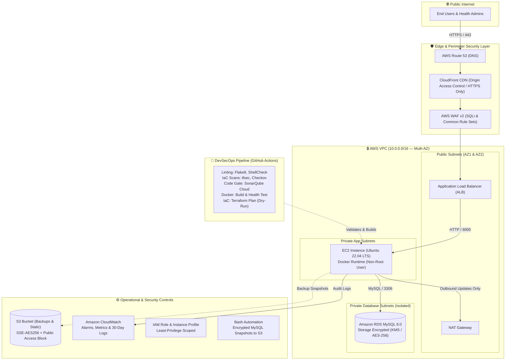

# Automated AWS Infrastructure & CI/CD Pipeline (SOC 2 Controls Baseline)

[](https://github.com/kris-2000/aws-terraform-soc2-devops-platform/actions)
[](https://sonarcloud.io/project/overview?id=kris-2000_aws-terraform-soc2-devops-platform)
[](https://www.terraform.io/)
[](https://github.com/kris-2000/aws-terraform-soc2-devops-platform/actions)

A production-style cloud infrastructure platform provisioning an isolated multi-tier AWS architecture and automated CI/CD pipeline for a containerized Healthcare Management microservice.

The infrastructure and deployment workflows implement the core technical controls mandated by **SOC 2 Trust Services Criteria (Security, Availability, and Confidentiality)** and **GDPR** data protection standards, including encryption at rest/in transit, network segmentation, least-privilege IAM, automated daily backups, and policy-as-code security scans.

---

## 🏛️ Architecture Overview

The platform isolates sensitive application and database workloads inside private subnets across multiple Availability Zones, enforcing traffic inspection through AWS WAF v2 and an Application Load Balancer (ALB).

### Architecture Diagram (Mermaid)



### Text Flow Diagram

```text
[End User] 
    │ (HTTPS)
    ▼
[AWS Route 53] ──► [CloudFront + AWS WAF v2] ──► [Application Load Balancer (Public)]
                                                              │ (Port 8000)
                                                              ▼
                                                   [EC2: Docker App (Private)]
                                                              │ (Port 3306)
                                                              ▼
                                                   [RDS MySQL Encrypted (Private)]
                                                              │
                                       ┌──────────────────────┴──────────────────────┐
                                       ▼                                             ▼
                          [S3 Encrypted Backups]                         [CloudWatch Logs & Alarms]
```

---

## 🔒 SOC 2 & Security Control Mapping Table

This repository implements technical safeguards corresponding directly to **SOC 2 Type II Trust Services Criteria (Security, Availability, Confidentiality)** and **GDPR** Article 32 requirements.

| Control Principle | SOC 2 Criteria | Technical Implementation Mechanism | Exact Code Reference |
| :--- | :--- | :--- | :--- |
| **Encryption at Rest (Database)** | **CC6.1, CC6.7** | AWS KMS customer-managed key encryption for RDS EBS storage (`storage_encrypted = true`). | [`terraform/compute_db.tf`](terraform/compute_db.tf#L87) |
| **Encryption at Rest (Storage)** | **CC6.1, CC6.7** | S3 bucket server-side encryption via AES-256 (`aws:kms` compatible) with strict Public Access Block. | [`terraform/edge_alb_waf.tf`](terraform/edge_alb_waf.tf#L18-L38) |
| **Encryption in Transit** | **CC6.6, CC6.7** | CloudFront viewer certificate enforcement (`redirect-to-https`) and ALB SSL/TLS termination. | [`terraform/edge_alb_waf.tf`](terraform/edge_alb_waf.tf#L84) |
| **Network Isolation & Segmentation** | **CC6.6** | Multi-AZ VPC (`10.0.0.0/16`) with compute and database strictly placed in private subnets with no public IPs. | [`terraform/vpc.tf`](terraform/vpc.tf#L25-L68) |
| **Least-Privilege Security Groups** | **CC6.6** | Tiered ingress: ALB allows 80/443; EC2 allows 8000 *only* from ALB SG; RDS allows 3306 *only* from EC2 SG. | [`terraform/vpc.tf`](terraform/vpc.tf#L120-L198) |
| **Layer 7 Threat Mitigation** | **CC6.6, CC7.1** | AWS WAF v2 Web ACL inspecting for SQL Injection (`AWSManagedRulesSQLiRuleSet`) and common OWASP exploits. | [`terraform/edge_alb_waf.tf`](terraform/edge_alb_waf.tf#L107-L140) |
| **Least-Privilege IAM Access** | **CC6.3** | EC2 IAM role strictly limited to scoped CloudWatch logs and encrypted S3 backup writes (zero `*` admin access). | [`terraform/iam_cloudwatch.tf`](terraform/iam_cloudwatch.tf#L25-L75) |
| **Non-Root Container Runtime** | **CC6.8** | Hardened multi-stage Dockerfile creating a dedicated `appuser` system group and running as non-root (`USER appuser`). | [`app/Dockerfile`](app/Dockerfile#L8-L12) |
| **Centralized Audit Logging** | **CC7.2** | 30-day retention CloudWatch log group with RDS general/error/slowquery export streams. | [`terraform/iam_cloudwatch.tf`](terraform/iam_cloudwatch.tf#L81-L86) |
| **Proactive Operational Monitoring** | **CC7.2, A1.1** | CloudWatch alarms monitoring high CPU utilization (>80%) and ALB 5XX error spikes (>5 errors/interval). | [`terraform/iam_cloudwatch.tf`](terraform/iam_cloudwatch.tf#L95-L135) |
| **Disaster Recovery & Daily Backups** | **A1.2, A1.3** | Automated Bash snapshot script producing encrypted database dumps pushed daily to S3 with 7-day retention. | [`scripts/linux_health_backup.sh`](scripts/linux_health_backup.sh#L26-L32) |
| **Static Security & Policy as Code** | **CC7.1** | Automated scanning in CI pipeline using `tfsec`, `Checkov`, `Bandit` (SAST), and `ShellCheck`. | [`.github/workflows/devops-pipeline.yml`](.github/workflows/devops-pipeline.yml#L40-L75) |

---

## 🛠️ Tech Stack & Tooling

* **Cloud Provider:** Amazon Web Services (VPC, ALB, EC2, RDS MySQL, S3, CloudFront, WAF v2, Route 53, CloudWatch, IAM)
* **Infrastructure as Code (IaC):** Terraform 1.6+ (modular HCL, S3 remote state lock ready)
* **Containers & Orchestration:** Docker (multi-stage non-root build), Kubernetes (Deployments, ClusterIP, Ingress, Probes)
* **CI/CD & DevSecOps:** GitHub Actions, Jenkins, SonarQube Cloud, Bandit, ShellCheck, tfsec, Checkov
* **Backend Application:** Python 3.12 (Healthcare Directory REST API + Web UI Dashboard)
* **Database:** MySQL 8.0 Engine with Automated Snapshots and KMS Encryption

---

## 🚦 DevSecOps CI/CD Pipeline

The GitHub Actions workflow (`.github/workflows/devops-pipeline.yml`) executes on every push and pull request:

```text
┌──────────────────────┐     ┌──────────────────────┐     ┌──────────────────────┐     ┌──────────────────────┐
│  1. Lint & Validate  │     │ 2. SonarQube Gate    │     │ 3. Docker Build/Test │     │  4. Terraform Plan   │
│                      │     │                      │     │                      │     │                      │
│ • Flake8 & Bandit    │────►│ • Static Analysis    │────►│ • Multi-Stage Build  │────►│ • OIDC AWS Auth      │
│ • ShellCheck         │     │ • OWASP Code Scan    │     │ • Probe /health      │     │ • Dry-Run Plan Only  │
│ • tfsec & Checkov    │     │ • Quality Gate Check │     │ • Push to DockerHub  │     │ • Never Auto-Apply   │
└──────────────────────┘     └──────────────────────┘     └──────────────────────┘     └──────────────────────┘
```

1. **Lint & Security Scans:**
   - `flake8`: Python syntax and PEP8 compliance.
   - `bandit`: Static Application Security Testing (SAST) for Python vulnerabilities.
   - `shellcheck`: Bash script validation for POSIX safety.
   - `terraform fmt & validate`: HCL syntax and internal consistency.
   - `tfsec` & `checkov`: Infrastructure-as-Code (IaC) policy and compliance scans detecting misconfigurations.
2. **SonarQube Cloud Security Gate:**
   - Full static code analysis covering bugs, vulnerabilities, and security hotspots.
3. **Container Build & Live Health Probe:**
   - Multi-stage Docker image build.
   - Spins up container in isolated test runner and validates HTTP `200 OK` on `/health`.
4. **Terraform Plan (Dry-Run):**
   - Connects to AWS via secure GitHub OpenID Connect (OIDC) without long-lived access keys.
   - Runs `terraform plan` to verify resource graph integrity without applying charges.

---

## 💻 Local Quickstart

### 1. Run the Web Dashboard & API Locally (Python Standard Library)

No dependencies required:

```bash
# Clone the repository
git clone https://github.com/kris-2000/aws-terraform-soc2-devops-platform.git
cd aws-terraform-soc2-devops-platform

# Run the application server
python app/app.py
```

Open your browser:
* **Interactive Web Dashboard:** [http://localhost:8000/](http://localhost:8000/)
* **ALB Health Probe (JSON):** [http://localhost:8000/health](http://localhost:8000/health)
* **Patient Records API (JSON):** [http://localhost:8000/patients](http://localhost:8000/patients)

### 2. Run with Docker (Production Container Runtime)

```bash
# Build the hardened non-root container
docker build -t hospital-app app/

# Run container on port 8000
docker run -d --name hospital-service -p 8000:8000 hospital-app

# Verify health status
curl http://localhost:8000/health
```

### 3. Run the Automated Compliance Scanner

Audit existing AWS resources against encryption, public exposure, and IAM least-privilege standards:

```bash
python scripts/soc2_gdpr_audit.py
```

### 4. Validate Terraform IaC

```bash
cd terraform
terraform init -backend=false
terraform validate
```

---

## 📂 Repository Structure

```text
aws-terraform-soc2-devops-platform/
├── app/
│   ├── app.py                  # Healthcare Web UI dashboard + REST API (WSGI ready)
│   ├── requirements.txt        # Gunicorn and production runtime dependencies
│   └── Dockerfile              # Multi-stage hardened non-root container build
├── terraform/
│   ├── main.tf                 # Provider configurations, variables, and outputs
│   ├── vpc.tf                  # Multi-AZ VPC, subnets, NAT, and security groups
│   ├── edge_alb_waf.tf         # Route 53, CloudFront OAC, S3, ALB, and AWS WAF v2
│   ├── compute_db.tf           # Private EC2 runtime, RDS MySQL (KMS Encrypted)
│   └── iam_cloudwatch.tf       # Least-privilege IAM roles and CloudWatch alarms/logs
├── k8s/
│   └── deployment-ingress.yaml # Production Kubernetes Deployment, Service, and Ingress
├── scripts/
│   ├── linux_health_backup.sh  # Operational Bash script for health checks and S3 backups
│   └── soc2_gdpr_audit.py      # Automated Python audit scanner for AWS compliance
├── .github/workflows/
│   └── devops-pipeline.yml     # 4-stage DevSecOps CI/CD pipeline (tfsec, Checkov, SonarQube)
├── Jenkinsfile                 # Declarative multi-stage Jenkins pipeline
└── docs/
    └── RUNBOOK_SOC2_GDPR.md    # Incident response, runbooks, and audit documentation
```

---

## 👤 Author

**KRISHNA PRASAD S**
* **GitHub:** [@kris-2000](https://github.com/kris-2000)
* **Role Focus:** Cloud Engineering, DevOps (AWS, Terraform, Kubernetes, CI/CD, DevSecOps)
